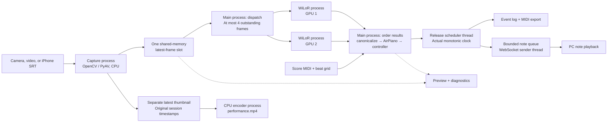

# Camera, video, and iPhone SRT streaming

`stage=streaming` runs OpenCV camera/video capture or PyAV SRT reception, parallel
WiLoR, ordered hand canonicalization, and the same AirPiano inference/controller
core as `full_song_real_time`. It supports one score per session with 30 fps camera,
video, or SRT input. The defaults are fast
WiLoR on GPUs 1 and 2, AirPiano on GPU 1, a live preview, a five-second preparation
countdown, and a 100 ms processing deadline. It prints MIDI trigger/release events
to the terminal, saves chord-event logs, and writes a small session video alongside
MIDI. Released notes are also sent to the configured PC over WebSocket for
playback. The video and MIDI share the same session start; audio is not recorded
or synthesized locally, and no local hardware MIDI port is opened.

## Design and package layout

This is a follower for a supplied score. MIDI defines the chord occurrences,
pitches, and beat-grid durations; the video estimates when the performance reaches
those occurrences. The runtime does not use the MIDI's performance onset times
as alignment ground truth. A camera session therefore needs a score, but it does
not need previously extracted hands or an aligned reference recording.

The implementation is grouped under one package:

```text
airpiano/streaming/
├── __init__.py   # Public stage: from airpiano.streaming import streaming
├── runtime.py    # Session orchestration, release scheduler, preview, logs, MIDI
├── core.py       # CanonicalFrameAdapter and shared AirPianoStepper
├── io.py         # Capture process lifecycle, shared memory, WiLoR workers
├── srt.py        # Optional PyAV SRT decoding and media timestamp mapping
├── recording.py  # Optional CPU video encoder and bounded thumbnail mailbox
└── midi_output.py # Optional persistent WebSocket note sender
```

`run.py` dispatches `stage=streaming` to the public package entry point. The
controller remains in `airpiano/full_song_real_time.py`, shared with the offline
stage. Both stages call the same inference step in `core.py`; the benchmark
adapter delegates to that step as well. The existing script commands remain
available under `scripts/`.



| Owner | Responsibility | Default compute |
| --- | --- | --- |
| Capture process | Read camera/video or receive SRT, timestamp frames, publish the latest image. | CPU / OpenCV or PyAV |
| WiLoR worker 1 | Detect hands and infer their poses for independent frames. | GPU 1 |
| WiLoR worker 2 | Read from the same job queue and process other frames. | GPU 2 |
| Main process | Dispatch work, restore frame order, canonicalize hands, run AirPiano, update score alignment, preview and log. | CPU plus AirPiano on GPU 1 |
| Scheduler thread in the main process | Release pending chord events independently of the next video frame. | CPU |
| Optional recording process | Encode a small video from an independent latest-thumbnail slot on the session timeline. | CPU / FFmpeg H.264 |
| Optional WebSocket thread | Maintain the PC connection and send fresh released-note messages without blocking inference or release scheduling. | CPU / network |

Each WiLoR worker owns its detector and pose model. Workers take jobs from a shared
queue as they become available; there is no fixed odd/even frame assignment.
GPU 1 is shared by its WiLoR worker and the main process's AirPiano model. WiLoR
can overlap across frames because each extraction is independent. Canonicalization
and AirPiano stay sequential because wrist displacement, hand history, and score
alignment depend on preceding frames.

OpenCV supplies BGR images; the SRT decoder converts to BGR for the same WiLoR backend. Images cross
process boundaries through shared memory rather than being serialized as full
1080p arrays through a queue. Worker result messages contain compact ragged hand
arrays and timing metadata. Fast mode uses FP16 WiLoR weights, a compiled backbone,
and `skip_blocks=True`. It sets float32 matmul precision to `high` inside each
worker; that process-wide setting is isolated from AirPiano. AirPiano uses the
configured BF16 setting independently.

### Startup before the session clock

1. Validate the source, score, devices, and preview configuration. Load the score
   and checkpoint, and compare FPS, target radius, and target delay against saved
   checkpoint settings. Older checkpoints without target-delay metadata are
   treated as having a zero delay, and that assumption is recorded.
2. Open capture in its own process. For video, decode and retain frame zero as the
   warmup example. For camera, request its resolution and frame rate, then wait
   until model warmup finishes before beginning reads. For SRT, receive the first
   decoded frame as the warmup example, then continuously drain incoming frames
   while the models warm up so no old video accumulates.
3. Spawn the WiLoR workers. Warm the full pose network with batches containing
   1, 2, and 3 hands, then run 10 complete backend warmup frames by default. Warmup
   tensors are created in the same context as production inputs so switching to
   one hand does not trigger a new compilation during the song.
4. Warm AirPiano for 30 steps using a temporary controller. Discard that controller
   and the temporary canonicalizer, then create fresh session state.
5. Print a separate message that the models are ready, followed by the preparation
   countdown: `5`, `4`, `3`, `2`, `1`, then `GO! Start playing.` by default. Wait for
   **GO** before performing. Capture and the release scheduler use one monotonic
   session epoch at the end of preparation. Video frame zero is retained, cameras
   start with fresh frames after discarding pre-start reads, and SRT continues
   draining incoming frames throughout preparation.

Initialization, model warmup, and the preparation countdown are excluded from
session throughput and latency. Set `streaming.countdown_seconds` to a nonnegative
integer to change the countdown; `0` skips the numbered countdown and still prints
GO. Camera driver buffering remains backend-dependent; a software read timestamp
cannot establish when the sensor exposed the image.

## Run a video or camera

From the repository root, using the existing `v2n` environment:

```bash
conda run --no-capture-output -n v2n python run.py stage=streaming \
  streaming.source.kind=video \
  streaming.source.video_path=/storage/jinxuan/data/AirPianoFull/Video/AIR/jinxuan_tabletop_aligned/beethoven_8_3.mp4 \
  streaming.score_midi=/storage/jinxuan/data/AirPianoFull/MIDI/AIR/jinxuan_tabletop_aligned/beethoven_8_3.mid \
  streaming.beat_path=/storage2/jinxuan/data/AirPianoFull/beats/AIR/jinxuan_tabletop_aligned/beethoven_8_3.txt \
  streaming.preview=false
```

Video replay follows the original frame times at 30 Hz. `streaming.preview=false`
is needed on a headless server. To use the preview, run on a machine with a display
and set it to `true`. Stop with Q or Esc in the preview, or Ctrl-C.

```bash
conda run --no-capture-output -n v2n python run.py stage=streaming \
  streaming.source.kind=camera streaming.source.camera_index=0 \
  streaming.score_midi=/absolute/path/to/score.mid \
  streaming.beat_path=/absolute/path/to/beats.txt
```

The default camera request is 1920 × 1080 at 30 fps. Choose another size with
`streaming.source.width` and `streaming.source.height`. The camera must support the
requested cadence. Camera frames use the live session clock; score MIDI provides
chord order and beat positions, not performance ground truth.

`streaming.beat_path=null` derives a beat grid from the MIDI tempo and meter and
writes it inside this session's output directory. Supply the aligned beat file
when replaying a dataset recording. Override `streaming.checkpoint` to choose a
model; supply the matching target-delay configuration for checkpoints trained
with advanced targets (for example `--config-name ablation_ahead100ms`). Effective
settings and available checkpoint metadata are checked and saved with the run.

Useful overrides:

| Setting | Default | Effect |
| --- | --- | --- |
| `streaming.wilor_devices` | `[cuda:1,cuda:2]` | Separate WiLoR worker processes. |
| `streaming.airpiano_device` | `cuda:1` | AirPiano model device. |
| `streaming.fast` | `true` | Fast WiLoR backend; `false` selects normal inference. |
| `streaming.deadline_ms` | `100` | Stop waiting for stale frames. |
| `streaming.drop_stale` | `true` | Keep the newest waiting capture under overload. |
| `streaming.max_inflight` | `4` | Bound outstanding inference work end to end. |
| `streaming.output_dir` | Automatic session path | Choose a new session directory. |
| `streaming.preview` | `true` | Display the latest frame and streaming diagnostics. |
| `streaming.countdown_seconds` | `5` | Preparation countdown after model warmup; a nonnegative integer, with `0` skipping the numbered countdown. |
| `streaming.log_midi_events` | `true` | Print trigger/release details to the terminal; JSON event logging and MIDI export remain enabled when `false`. |
| `streaming.recording.enabled` | `true` | Save a synchronized small session video; `false` disables recording only. |
| `streaming.recording.max_dimension` | `640` | Longest output edge in pixels; inference keeps the original resolution. |
| `streaming.recording.fps` | `30` | Recording timeline frame rate. |
| `streaming.recording.crf` | `30` | H.264 quality setting; higher values usually produce smaller files. |
| `streaming.midi_output.enabled` | `true` | Send released notes to the PC over WebSocket; `false` leaves local logging/export enabled. |
| `streaming.midi_output.url` | `ws://10.5.149.66:8765` | PC WebSocket receiver. |
| `streaming.midi_output.capacity` | `32` | Bound pending note messages. |
| `streaming.midi_output.max_age_ms` | `100` | Discard stale released-note messages before sending. |
| `streaming.midi_output.open_timeout_seconds` | `1` | Bound each connection attempt. |
| `streaming.midi_output.close_timeout_seconds` | `0.5` | Bound the WebSocket close handshake. |
| `streaming.midi_output.reconnect_seconds` | `1` | Wait between reconnect attempts. |

For one WiLoR GPU, pass `'streaming.wilor_devices=[cuda:1]'`. Fast mode remains
isolated in the WiLoR worker processes. Streaming never reads or writes normal
ragged or canonical preprocessing caches, so its fast outputs cannot mix with
those caches.

## Receive an iPhone SRT stream

The supplied standalone receiver example is integrated into the capture process
using PyAV rather than depending on OpenCV's particular FFmpeg build. SRT reception
is optional: camera/video sessions do not import PyAV. The current `v2n` environment
already has PyAV 14.1.0 with SRT support. For another environment:

```bash
python -m pip install -r requirements-srt.txt
```

PyAV must be linked to an FFmpeg build with `libsrt` support; an installed system
`ffmpeg` supporting SRT does not prove that PyAV's separate libraries support it.
The receiver uses MPEG-TS and decodes the first video stream only. Incoming audio
is ignored. Session video recording saves a reduced-size image stream; received
audio is not recorded or decoded.

Start AirPiano on the GPU machine:

```bash
conda run --no-capture-output -n v2n python run.py stage=streaming \
  streaming.source.kind=srt \
  streaming.score_midi=/absolute/path/to/score.mid \
  streaming.preview=false
```

The default receiver listens on `0.0.0.0:9001` with a requested SRT latency of
100 ms. On the iPhone, use an SRT-capable app such as
[Moblin](https://github.com/eerimoq/moblin), and configure:

| Phone setting | Value |
| --- | --- |
| Protocol | Plain SRT (`srt://`), caller mode |
| Destination | `srt://GPU_MACHINE_IP:9001` |
| Video | H.264, 1920 × 1080, 30 fps, landscape |
| SRT latency | 100 ms as an initial setting |
| Orientation / output size | Keep fixed throughout the session |

Use the GPU machine's reachable LAN/VPN address, not `0.0.0.0` or the phone's own
`localhost`. The network must allow UDP to port 9001. Plain SRT is supported;
SRTLA bonding needs a separate relay and is not accepted directly. Disable any
mirroring or scene effects that change hand geometry. The configured source width
and height apply to local cameras; SRT uses the actual decoded dimensions.

Start the receiver command, then start streaming on the phone when the receiver
reports it is opening SRT. After model warmup, the terminal reports that the models
are ready and counts down `5`, `4`, `3`, `2`, `1`. Wait for **`GO! Start playing.`**
before performing. The phone must continue streaming throughout warmup and the
countdown; those frames are drained without entering model history. The first
decoded frame after the session epoch at GO establishes the media clock. Stop the
AirPiano session with Ctrl-C (or Q/Esc in the preview) before stopping the phone
stream to finish without a disconnect error.

The listener URL can be overridden. Keep the inner double quotes below: Hydra
needs them when the URL contains `=` and `&`.

```bash
conda run --no-capture-output -n v2n python run.py stage=streaming \
  streaming.source.kind=srt \
  'streaming.source.srt_url="srt://0.0.0.0:9001?mode=listener&latency=100000"' \
  streaming.source.srt_open_timeout_seconds=120 \
  streaming.source.srt_read_timeout_seconds=5 \
  streaming.score_midi=/absolute/path/to/score.mid \
  streaming.preview=false
```

The URL follows [FFmpeg SRT options](https://ffmpeg.org/ffmpeg-protocols.html#srt):
`latency=100000` is **microseconds**, meaning 100 ms. A sender's higher latency
request can increase the negotiated buffering. Open/read timeouts are **seconds**,
using [PyAV's timeout tuple](https://pyav.basswood.io/docs/stable/api/_globals.html).
The open timeout includes waiting for the phone and initial stream probing.

### SRT timestamps and processing latency

Sender presentation timestamps (PTS) determine temporal spacing. If frames arrive
in a burst, they retain their original 30 Hz positions rather than being assigned
the same arrival-time slot. PTS gaps become missing-hand history using the existing
streaming policy. Duplicate slots are discarded. Known frame rates must be within
0.1 Hz of 30 (including 29.97); this does not convert arbitrary 25/60 fps streams.

At the first decoded frame after GO, media PTS is anchored to local decode-ready
time.
That fixed anchor maps subsequent PTS into `source_time` for the model and event
scheduler. No silent clock rebasing occurs. Arrival jitter is logged separately:

```text
source_time = first_decode_time - session_epoch + PTS - first_PTS
processing_latency = inference_completed_at - decoded_at
arrival_pts_drift_ms = (decoded_at - session_epoch - source_time) * 1000
```

For SRT, `scheduled_at`, `acquired_at`, and `decoded_at` share the local decode-ready
timestamp, taken before BGR conversion. The 100 ms processing deadline therefore
measures receiver work after decoding, including conversion, hand inference, and
AirPiano. It excludes phone exposure/encoding, transport, SRT buffering, and video
decoding. PTS and drift cannot establish absolute phone-to-result delay without
clock synchronization or an optical measurement. Drift can be negative if later
frames arrive with less delay than the first anchor frame.

A 100 ms SRT buffer is additional to inference latency. The earlier local-video
63 ms average does not establish a 100 ms phone-to-result budget. End-to-end latency
and chord accuracy over the actual iPhone network still need measurement.

`frames.csv` adds raw `source_pts_seconds`, session-relative `decoded_at`, and
`arrival_pts_drift_ms`. The summary includes post-start decoded read counts,
duplicate counts, and drift statistics for processed frames. Missing slots are
labelled `source_gap_or_capture_overwrite`, because the latest-frame mailbox cannot
always distinguish a missing media frame from an overwritten decoded image.

SRT always uses the bounded latest-frame policy; no-drop replay is video-only.
A disconnect, read timeout, missing/backward PTS, implausible forward clock jump,
or resolution change ends the session with an error while preserving released
events and partial outputs. There is no automatic reconnect within a score session.
Restart AirPiano after reconnecting the phone. Shutdown is bounded even when the
native decoder is waiting for input.

### SRT validation

Run the CPU regressions plus real localhost SRT transport checks with:

```bash
AIRPIANO_TEST_SRT_INTEGRATION=1 conda run --no-capture-output -n v2n \
  python -m unittest discover -s tests -p 'test_streaming*.py' -v
```

The optional transport checks require an SRT-enabled `ffmpeg` executable and PyAV.
They send a generated H.264 MPEG-TS stream over localhost, verify decoded frames
and timestamps, and check listener shutdown and shared-memory cleanup. The default
unit-test run skips those two network checks. These checks do not substitute for
physical iPhone, network, preview, or model-accuracy validation.

A short real GPU smoke test on 2026-11-02 also sent the existing 1080p30 tabletop
Beethoven recording through localhost SRT into fast WiLoR on GPUs 1/2 and AirPiano
on GPU 1. After warmup, the 9.88-second session captured 296 frames and processed
294, at 29.97 captured fps and 29.76 processed fps. Local processing latency was
64.83 ms average, 77.28 ms p95, and 100.57 ms maximum; one completed frame exceeded
100 ms. One frame was overwritten or missing in the source timeline, and one was
unfinished at intentional Ctrl-C shutdown. There were zero deadline-driven drops
and no cleanup errors; MIDI and 21 released chord records were saved. See the
[saved summary](../outputs/streaming_srt_validation_20261102T205306Z/session/summary.json)
and [commands](../outputs/streaming_srt_validation_20261102T205306Z/commands.json).
This is a short transport/model integration check, not a complete-song accuracy
comparison or a physical iPhone/network latency measurement.

## Frame clocks, ordering, and dropping

All runtime times share a `time.perf_counter()` origin. CSV timestamps are saved
relative to that session origin, so capture, workers, the main process, and the
release scheduler can be compared on the same timeline.

| Source | Logical frame position | Source time and processing-latency origin |
| --- | --- | --- |
| Video | Original frame index `i`. | Frame availability is scheduled at `i / 30` seconds. Subsequent decode, dispatch, queueing, and inference contribute to latency. Frame zero is predecoded during startup. |
| Camera | `floor(30 × seconds_since_session_start)` at read completion. | Actual read-completion time. Exposure and time already spent inside the camera/driver are outside this measurement. |
| SRT | First local slot plus rounded 30 Hz positions from relative sender PTS. | Model source time follows anchored PTS; processing latency begins at local decode readiness, excluding phone/transport/decode latency. |

Video replay waits for each original timestamp. It does not run the file as fast
as decoding allows. Camera stalls leave gaps in the logical 30 Hz sequence, and
multiple camera reads in one slot are discarded after the first accepted read.
The actual camera source timestamp is retained rather than replaced with its
rounded slot time. Camera read counts and duplicate-read counts are reported
separately from logical frame positions.

There are three bounded pieces of pending work: one capture mailbox, one frame
waiting for dispatch in the main process, and at most four outstanding inference
frames by default. A new capture replaces an older unconsumed capture or waiting
frame. The four-frame limit spans dispatch, WiLoR, result ordering, and AirPiano
consumption; it is not merely the GPU input queue length.

WiLoR results may arrive out of order. The main process normally waits for the
oldest outstanding frame before applying canonicalization and AirPiano. If that
frame reaches the deadline, it records a drop and can proceed to later frames.
An expired GPU job still occupies an outstanding-work slot until the worker
actually returns; its late result is discarded. Expired waiting captures are
also dropped before dispatch. This prevents late results from moving the
controller backward or allowing an unbounded queue to build up.

The next accepted inference fills skipped logical positions with zero hand poses
and absent-hand masks. Their `hand_presence` is false while `frame_mask` remains
true: these are real elapsed positions, not batch padding, so temporal attention
still sees the missing observations. Those positions do not produce predictions.
The canonicalizer resets its previous-pose state across a gap, so
wrist displacement is not computed between nonadjacent frames. Dropped frames
count against processed throughput and remain in the source timeline used for
validation.

The 100 ms deadline is checked before accepting a result for AirPiano. It cannot
interrupt GPU work already running, and a frame admitted just before the deadline
can finish after it. The summary therefore reports completed frames over 100 ms
as well as frames discarded for reaching the configured deadline. This is a
latency-control policy, not a hard real-time guarantee.

For the no-drop video reference, set `streaming.deadline_ms=null` together with
`streaming.drop_stale=false`. Capture then waits for downstream capacity instead
of overwriting frames. Original source timestamps are preserved, so any backlog
appears as increased latency rather than a slower artificial source clock.

## Shared inference and score alignment

For each accepted frame, `CanonicalFrameAdapter` selects the canonical left/right
hands from WiLoR's detections and produces pose `[2, 21, 3]` and presence `[2]`
arrays. Its postprocessing uses the previous adjacent frame for wrist motion.
The runtime applies the configured hand transform exactly once before calling
`AirPianoStepper`. Offline inference already has transformed hands and passes them
directly to the same stepper.

The stepper tokenizes the complete score once. Each forward uses the controller's
current chord window (50 chords by default, or the whole score if shorter) and
hand history from the controller's chosen starting frame through the current
frame. Each forward rebuilds and evaluates that selected history; there is no
persistent Transformer key/value cache. It reads the last frame's alignment
probabilities, then updates the controller. This shared step has no camera reader,
frame-pacing loop, or cache writer; live I/O and clock ownership belong to `runtime.py` and `io.py`.

The controller maintains one latch per score occurrence. A probability above
0.5 triggers an unlatched occurrence; falling below 0.5 rearms it. Each event
updates the existing full-score dynamic program. Successful matches establish
timing anchors and reposition the chord window; otherwise the window advances
according to the existing controller rule. The anchor estimate also determines
where the next hand-history slice starts. Current behavior queues detected
occurrences for release even when their DP match does not improve the best path;
DP success controls alignment updates, rather than acting as a release filter.
Each occurrence is released at most once, and repeated triggers preserve its
first pending release time.

History is retained on the CPU because the controller can move its starting
position backward, including back to frame zero. Images and outstanding work are
bounded, but compact hand history and event records grow through the session.
This is a one-song session, not an indefinitely fixed-memory service. Extended
idle time or lost alignment can grow the active history and inference cost;
restart between songs.

### Processing latency and chord release timing

The frame processing measurement is:

```text
processing_latency = completed_at - scheduled_at
```

For video, this includes decode, shared-memory transfer, queueing, WiLoR,
canonicalization, and AirPiano. For camera it begins at software read completion;
for SRT it begins at local decode readiness before BGR conversion.
`capture_to_completion_ms` is also logged, excluding the video's decode interval.
WiLoR plus canonicalization, AirPiano, and remaining overhead partition each
frame's total processing time; their p95 and maximum values need not add up,
because the extremes can occur on different frames.

The predicted musical onset uses the trained target convention:

```text
predicted_onset = source_time + target_radius_seconds / 2 - target_delay_seconds
release_time ≈ max(predicted_onset, time_prediction_became_available)
```

The default radius is 0.2 seconds and target delay is zero, giving a 0.1-second
offset from the triggering frame's source time. This compensates for the leading
half-height crossing of the triangular training target; it does not mean every
physical note is played 100 ms late. For example, a trigger from source time
10.000 s may finish inference at 10.063 s and be released at its predicted onset
of 10.100 s, after approximately 37 ms of scheduler waiting. If inference finishes
after the onset, it releases the pending event as soon as it runs. Scheduler and operating-system jitter are
included in the recorded actual release time. A target delay of −0.1 seconds
changes the offset to 0.2 seconds to account for targets trained earlier.

The scheduler runs in its own CPU thread and wakes on new events or the next due
onset. It continues while capture or inference waits. Short controller operations
are locked; the GPU forward does not hold that lock. Live mode calls release
scheduling with the actual monotonic time and adds no simulated processing delay.
The offline `full_song_real_time` stage preserves its existing simulated 50 ms
clock. These two clocks share model/controller behavior but have different timing
semantics. Recorded releases are software events, not measured speaker or external
MIDI-device output.

## Session outputs and lifecycle

MIDI events are printed to the terminal by default as they occur. A trigger line
shows the score chord occurrence, MIDI pitches, confidence, and predicted onset
in session-relative seconds. A release line shows its notes, actual release time,
and duration. Triggers and releases are separate: a predicted onset can still be
pending when its trigger is logged, and the release records when the scheduler
actually emits the event. Release events feed the WebSocket output when enabled;
console printing itself does not control playback. No local synthesizer or hardware
MIDI output is used.

Use `streaming.log_midi_events=false` to suppress only the console event lines.
`events.jsonl` still saves triggers and releases, and `performance.mid` still
exports released notes. WebSocket playback is controlled separately by
`streaming.midi_output.enabled`; suppressing console event lines does not disable
it. Startup messages, the countdown, and periodic throughput reports remain visible.

Sessions are written under `outputs/<project>/streaming/<timestamp>` unless an
output directory is supplied. An existing session directory is not overwritten.
The main outputs are:

| File | Contents |
| --- | --- |
| `config.yaml` | Resolved effective configuration. |
| `session.json` | Source, devices, model timing checks, warmup metadata, and software versions. |
| `frames.csv` | Logical positions, processed/drop status and reason, stage timestamps, latency, history length, and detected-hand count; written incrementally. |
| `events.jsonl` | Trigger, release, and `midi_output` transport records. Occurrence IDs are one-based; `release_time` is actual session-relative scheduler time. Transport records report local send/drop timing, with no PC playback acknowledgment. |
| `performance.mid` | Released chord pitches at their actual release times, with the controller's one-second note duration and velocity 64. |
| `performance.mp4` | Optional reduced-size 30 fps H.264 video with the same zero-time origin as MIDI; no audio track. |
| `recording.json` | Recording status, dimensions, frame accounting, duration, file size, and encoder errors; also included in `summary.json` under `recording`. |
| `midi_output.json` | WebSocket connection, send/drop counts, timing, and errors; also included in `summary.json` under `midi_output`. |
| `summary.json` | Completion/error status, cleanup errors, frame counts, throughput, latency average/p95/max, deadline misses, and peak outstanding work. |
| `score_beats.txt` | Derived beat grid, only when no beat file was supplied. |

### Live note playback on the PC

By default, each released chord is sent to `ws://10.5.149.66:8765`. The receiver
plays the supplied notes for one second. Start the PC receiver before the session,
then use the normal camera, video, or SRT command. To select a different receiver:

```bash
conda run --no-capture-output -n v2n python run.py stage=streaming \
  streaming.source.kind=srt \
  streaming.score_midi=/absolute/path/to/score.mid \
  streaming.preview=false \
  'streaming.midi_output.url=ws://10.5.149.66:8765'
```

Messages are WebSocket text containing either a single decimal MIDI pitch, such as
`60`, or a compact JSON pitch list, such as `[60,64,67]`. They contain no timestamp,
velocity, duration, or note-off message. The PC supplies its own one-second playback
duration. A chord's notes travel together in one message so their playback can
begin together on the receiver.

The sender uses a persistent `websockets.sync.client.connect` connection with
`proxy=None` and `compression=None`. The dependency is pinned as
`websockets==17.4` in `requirements.txt` and is installed in the existing `v2n`
environment. The connection may open during startup, but startup does not send
any notes. Only actual controller **release** events
enter this output queue. A raw trigger can arrive before its predicted onset, so
sending trigger messages would play notes early or duplicate a chord. The release
scheduler waits for the predicted onset, or releases immediately if the prediction
is already late. No notes are sent during model warmup or the preparation countdown.
The controller's occurrence deduplication remains in force; separate occurrences
of the same pitch can still play repeatedly.

Connection establishment, sending, and reconnecting happen on a dedicated thread.
Inference and the release scheduler do not wait for network I/O. The pending queue
is bounded to 32 messages by default. A disconnected connection or full queue
drops new note messages immediately. Queued notes older than 100 ms, measured from
the actual local release instant, are discarded before sending. Disconnecting
also clears pending notes, and reconnecting carries future releases only. Failed sends
are not retried: without a receiver acknowledgment, a failed send can still have
reached the PC, and retrying could duplicate playback. A failed connection produces
a warning and reconnection attempts while local inference, logs, video recording,
and MIDI export continue.

`midi_output.json` and `summary.json` → `midi_output` report the transport outcome
separately from chord inference. Transport records also appear in `events.jsonl`
with `kind="midi_output"`: they include status, chord/pitch information when
applicable, and local queue/send timing. `session_time` uses the session epoch,
while startup connection records have a null `session_time`. A successful send
means the local WebSocket library accepted the message; the current protocol does
not acknowledge receipt, playback start, or speaker output.
The report counts submitted, accepted, and sent events separately, with drop
counts for disconnected/full/stale/shutdown/invalid messages, send failures,
connections/reconnections, and bounded-shutdown status. Its `queue_delay_ms` and
`local_release_to_send_ms` statistics describe successful local sends only.
Network transit, receiver scheduling, synthesis, and audio buffering therefore add
unmeasured delay after the recorded release. `performance.mid`, `events.jsonl`, and
the synchronized video remain on the local session timeline and are not shifted
to estimate PC playback time.

Set `streaming.midi_output.enabled=false` for local-only validation or when no PC
receiver is available. This disables network note output without changing saved
MIDI or video. Tests use local loopback receivers; automated validation does not
send test notes to the configured PC address.

Run the dedicated sender tests, including their local loopback WebSocket server,
without contacting the configured PC:

```bash
conda run --no-capture-output -n v2n python -m unittest discover \
  -s .codex/tests -t .codex -p 'test_streaming_midi_output.py' -v
```

### Video recording synchronized with MIDI

Video recording is enabled by default for camera, local video, and SRT sources.
The session saves `performance.mp4` beside `performance.mid`; these are separate
files that can be placed at time zero together in a video or music editor.
The MP4 has no audio track, and MIDI requires an instrument to produce sound.
Use `streaming.recording.enabled=false` to disable video recording while keeping
inference, event logging, and MIDI export. Recording requires an `ffmpeg` executable
with the `libx264` encoder; if it is unavailable, inference continues with a recording
warning. This recording dependency is separate from PyAV used for SRT reception.

The default recording is 30 fps H.264 with a longest edge of 640 pixels, preserving
aspect ratio with even dimensions. It uses the `ultrafast` preset, CRF 30, and one
CPU encoding thread to keep the file and encoding cost small. The WiLoR input
retains its original resolution: only the recording copy is resized. The encoder
writes a fragmented MP4 so completed fragments can survive an interrupted session.

Capture offers every accepted post-GO source image to a separate bounded thumbnail
mailbox before publishing it to the inference mailbox. Inference drops therefore
do not automatically become recording drops. Encoding runs in its own CPU process;
a slow encoder overwrites old waiting thumbnails instead of making WiLoR wait.
Recording still adds thumbnail resizing and memory-copy work in the capture process,
so performance must be measured with it enabled rather than assumed identical.

Both files use the monotonic session epoch announced by **GO**. Warmup and countdown
images are excluded. Video timestamps come from each frame's `source_time`: the
original frame times for video replay, session acquisition time for cameras, and
anchored sender PTS for SRT. Each image is placed at its nearest 30 Hz recording
position, with at most 16.7 ms of frame-grid quantization. Missing positions repeat
the previous image; positions before the first received image are black. This
preserves elapsed time through network or capture gaps instead of shortening the
saved video.

MIDI note onsets remain the actual software release times. The recording does not
move notes earlier to hide inference or scheduling delay. For SRT, shared timeline
alignment also does not establish the phone's absolute capture time: its PTS clock
is still anchored to the first post-start local decode, as described above.

On normal EOF or interruption, finalization repeats the last image as needed to
cover session elapsed time and the final exported note-off. Thus a released note's
one-second duration remains inside the video timeline even when input ends just
after its note-on. Stopping before GO produces no performance video.

`recording.json` and the `recording` entry in `summary.json` separate offered and
submitted images, overwritten or skipped recording images, repeated/leading-black
output frames, duration, output dimensions,
file size, and encoder errors from inference statistics. `offer_cost_ms` measures
the capture-side thumbnail/copy cost, while `late_frames` counts thumbnails whose
30 Hz output position was already committed. An unavailable encoder or
recording failure disables recording and is reported without aborting AirPiano.
A forced process termination can leave only the already completed video fragments;
inspect the recording report before treating a partial file as a complete session.

The recording smoke test received native 1080p30 tabletop video over localhost SRT
through fast WiLoR on GPUs 1/2 and AirPiano on GPU 1. It produced a 640 × 360 H.264
MP4 of 331 frames / 11.033 seconds / 485,246 bytes with no audio. Its start PTS is
zero, and its end covers the final MIDI note-off at 11.0229 seconds. MIDI note-on
positions match recorded actual releases within 0.252 ms, the MIDI tick grid.
The video contains 301 captured images, two leading black frames, and 28 repeated
positions; one recording thumbnail was overwritten. See the
[synchronization check](../outputs/streaming_srt_recording_validation_20261102T212208Z/synchronization_check.json)
and [recording report](../outputs/streaming_srt_recording_validation_20261102T212208Z/session/recording.json).

In that short run, 299 frames were processed over 10.093 seconds (29.62 processed
fps), with 69.78 ms average, 87.15 ms p95, and 105.41 ms maximum local processing
latency. Six processed frames exceeded 100 ms; no frames were dropped by the
inference deadline. Four logical positions were unprocessed: two source/capture
gaps and two at intentional shutdown. The measured capture-side recording offer
cost was 1.59 ms average / 5.66 ms maximum. These values demonstrate a working
recording pipeline, not zero overhead or a strict 30 fps guarantee. The earlier
unrecorded SRT run used a different segment and session setup, so differences in
latency between the runs do not isolate recording cost. See the
[session summary](../outputs/streaming_srt_recording_validation_20261102T212208Z/session/summary.json).

### Preview and shutdown

Preview shows the latest captured image and the most recently completed alignment
state, including current matched chord, processing latency, processed fps, and
drops. It does not wait for the displayed frame to finish inference. Q, Esc,
closing the preview window, or Ctrl-C stops the session.

Normal video EOF first finishes or retires accepted work, then drains scheduled
chord releases. Interruption preserves releases already emitted and marks accepted
unfinished frames as stopped. Capture, worker, and scheduler failures propagate
as session errors. Cleanup stops and joins processes, terminates unresponsive
children when necessary, unlinks shared-memory buffers, and closes the preview
and logs. The runtime attempts to preserve MIDI and a summary even after another
cleanup step fails; an unwritable output location can still prevent saving them.
A failed or interrupted run must not be counted as a complete recording.

`throughput_processed_fps` divides processed frames by actual session elapsed
time, excluding warmup and the preparation countdown and including final
processing/event drain.
`processed_over_source_fps` divides by the original video's duration; it alone
cannot prove that inference kept up with real time. For camera, logical slot counts,
accepted-capture counts, and raw read counts can differ: stalls leave empty slots,
and extra reads within one slot are recorded as duplicates. Video validation computes
accuracy against aligned MIDI; live camera sessions do not have that ground truth.

## Validate two complete tabletop recordings

```bash
conda run --no-capture-output -n v2n python scripts/validate_streaming.py \
  --output-dir outputs/streaming_validation
```

The validation runner always forces `streaming.midi_output.enabled=false` for
every session, including when supplied overrides request `true`. Dataset
validation therefore never sends notes to the PC; use `run.py stage=streaming`
to exercise live WebSocket output.

By default this selects the first two records in `splits/air_tabletop.txt`. Each
record runs twice, using fast WiLoR on GPUs 1 and 2 and AirPiano on GPU 1:

1. Bounded streaming with the 100 ms deadline and stale-frame dropping.
2. A reference replay with `streaming.deadline_ms=null` and
   `streaming.drop_stale=false`. Capture uses backpressure, so every frame reaches
   inference, while retaining its original source timestamp. Any accumulated
   processing delay remains visible in the actual release times.

The runner requires complete videos, verifies captured/processed/drop counts,
and rejects drops in the reference. It evaluates actual releases against physical
onsets from each recording's aligned MIDI using the existing production metrics.
All original source frames contribute to the ground-truth target construction;
dropping frames cannot improve the reported denominator. C-AR is micro-averaged
as summed correct-chord counts divided by summed target-chord counts. @4, @8, and
@16 correspond to ±133, ±267, and ±533 ms at 30 fps.

`inputs.json` records the selected videos, overrides, and SHA256 hashes of the
streaming runtime, controller, entrypoint, validation script, and configuration.
Each subprocess also records its exact arguments and source hashes in
`logs/*.sources.json`; the report checks that all sessions used the initial sources.
`comparison.json` contains per-record latency, throughput, drops, C-AR, aggregate
counts, pooled latency statistics, and bounded-minus-reference changes in
percentage points. The requested
performance targets are 30 processed fps and p95 processing latency below 100 ms;
report maximum latency and deadline misses alongside them. A finite recording's
elapsed throughput can be slightly below 30 even without drops because the final
frame and scheduled events finish after the source ends.

Use `--records RECORD_ID ...` for explicit inputs and `--override KEY=VALUE` for
matching model/data configuration. A completed set of runs can be re-evaluated
with `--evaluate-only`. Existing sessions are never overwritten by a new run.

```bash
conda run --no-capture-output -n v2n python -m unittest discover \
  -s tests -p 'test_streaming*.py' -v
```

Headless video validation exercises capture, GPU workers, ordering, the scheduler,
and metrics. Physical camera behavior and GUI preview still require a machine
with those devices; this server currently has neither a camera device nor a
configured display.

### Measured result, 2026-11-01

On two RTX 4090s (fast WiLoR on GPUs 1 and 2; AirPiano on GPU 1), both complete
recordings supplied 4,426 frames per mode. The bounded run processed every frame
at **29.994 fps**, with **62.84 ms average / 68.37 ms p95 / 94.85 ms maximum** frame
latency, zero drops, and zero frames over 100 ms. The uncapped reference processed
all frames at 29.992 fps, with 69.87 ms p95 and 90.97 ms maximum latency. Both
achieved **90.03% C-AR@8 (614/682 chords)**, a **0.00 percentage-point** difference.
All four runs used identical source hashes. These are headless video measurements;
physical camera and preview checks remain device-dependent. See the
[complete paired report](../outputs/streaming_validation_20261101_v2/comparison.json).
