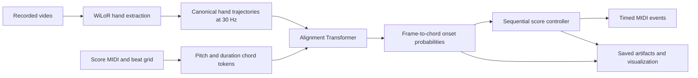

# AIR-Piano: Repository Summary for Paper Writing

This document summarizes the implementation at revision `4284baf`, inspected on 2026-10-23. It provides draft paper text, technical details, and an experiment checklist. Implementation facts come from the linked source files; proposed framing and outstanding experiments are identified separately. Dataset counts describe split-file entries, not verified usable recordings.

## 1. Suggested title and abstract

**Suggested title:** AIR-Piano: Score-Guided Alignment of Hand Motion for Tabletop Piano Performance

**Draft abstract:** AIR-Piano converts visually observed piano-like hand gestures into timed musical events using a supplied symbolic score. The system extracts three-dimensional hand poses from video, represents the score as a sequence of pitch-and-duration chord tokens, and learns a frame-to-chord onset alignment model. A Transformer combines a bidirectional score encoder with causal hand-motion processing and cross-attention to candidate score chords. Training uses aligned hand trajectories and MIDI-derived chord onsets, with triangular temporal targets and a masked binary cross-entropy objective. During sequential inference, thresholded onset predictions drive a dynamic-programming controller that updates the score window and schedules MIDI events. The repository provides preprocessing, training, simulated online inference, visualization, and evaluation using chord-position accuracy, onset alignment rates, timing error, and coverage. Its experimental setup includes piano-performance data and AIR piano/tabletop recordings. Quantitative conclusions and end-to-end live latency measurements should be added after a provenance-checked evaluation.

## 2. Research problem and contribution framing

The implemented task is **score-conditioned visual performance alignment**. Given hand-motion frames and a known MIDI score, the system estimates when successive score chords are performed. The score supplies pitches; the learned model supplies alignment evidence for their timing. Audio is used to prepare training annotations, but it is not an input to the alignment network at inference.

For a paper, the repository supports describing these system components:

1. A visual-to-symbolic alignment pipeline that represents hands through local finger geometry, wrist displacement, and explicit detection-presence features.
2. A Transformer that combines causal motion context with pitch-and-duration score context to predict chord-onset likelihoods.
3. A sequential score-following controller that maintains alignment anchors, selects candidate chords, and produces timed MIDI events.
4. An evaluation workflow covering piano and tabletop recordings, clip-duration variants, and configurable training ablations.

These are implementation-backed contribution candidates. Claims of novelty, superiority, robustness, or generalization require related-work comparisons and experimental evidence.



## 3. Data preparation and representations

### 3.1. Training supervision

Each recording has a shared relative ID across video, MIDI, beat annotations, raw hand detections, and canonical hand caches. Training expects aligned MIDI/beat information and hand trajectories on the same recording clock.

The supplied preprocessing scripts use **TransKun 2.0** to transcribe piano audio to MIDI and **Beat This!** with DBN postprocessing to estimate beats. WiLoR extracts hands from video. Consequently, supervision generated by this workflow includes automatic transcription and beat-estimation errors; it should be described as automatically derived supervision rather than uniformly human-annotated ground truth.

For inference, existing hand caches are reused or generated from video. Missing beat files can be constructed from MIDI tempo and meter metadata. A supplied score need not already match the video timing. The [README](README.md) states that the AIR recordings use musical-subdivision annotations to establish alignment for evaluation; the annotation procedure and its reliability are not fully documented here.

Sources: [audio transcription](scripts/preprocess_transkun.py), [beat estimation](scripts/preprocess_beats.py), [input preparation](airpiano/song_input.py).

### 3.2. Hand representation

WiLoR detections are converted to a canonical sequence of shape `T × 2 × 21 × 3`, with a `T × 2` presence mask. The two slots represent anatomical left and right hands.

- For each handedness in each frame, select the detection with the lowest image-space wrist, breaking ties by detector confidence. This is a per-frame selection heuristic rather than an identity tracker.
- Represent the 20 non-wrist joints relative to the wrist. Initially recover the wrist in camera coordinates, then replace it with displacement between consecutive canonical frames when both detections are present. This is displacement per frame, without division by the frame interval.
- Resample to 30 Hz by linear interpolation at frame centers. An interpolated hand is valid only when present at both interpolation endpoints; absent slots are zero-filled.
- Apply the default coordinate transform: zero offset and a factor of 10 on all three axes.

Flattening 126 coordinate values and appending two presence bits yields **128 features per frame**. Presence bits distinguish an absent hand from a valid hand with small coordinates. A real frame with no detected hands is still a real model time step; padding is handled by a separate mask.

Sources: [canonicalization](airpiano/preprocessing/canonical.py), [coordinate transform](airpiano/data/hands.py), [hand extraction defaults](airpiano/preprocessing/video.py).

### 3.3. Score representation

The MIDI reader merges tracks, accounts for tempo, pairs repeated notes by channel and pitch in FIFO order, and uses physical note-off times. Sustain-pedal messages are ignored by the alignment note reader.

Note onsets and offsets receive beat-grid coordinates with **24 subdivisions per beat**. Allowed within-beat offsets are `{0, 3, 4, 6, 8, 9, 12, 15, 16, 18, 20, 21}`. Notes sharing a quantized onset position are grouped into a chord. Its physical onset is the mean of the constituent note-on times. Its duration feature is the tick distance to the next chord; the final chord uses its latest note offset.

Each chord token contains:

- A **128-dimensional pitch multihot**, covering MIDI pitches 0–127. Repeated instances of the same pitch collapse to one active value.
- A **96-dimensional duration one-hot**, with duration ticks clipped to `[1, 96]` before one-based binning.

The resulting token has **224 dimensions**. Velocity, individual note durations, finger assignments, and pedal state are not input token features. Physical onset seconds create training labels; the network receives score pitches, quantized durations, and sequence positions.

Sources: [MIDI parsing and chord construction](airpiano/data/midi.py), [tokenization](airpiano/data/tokenization.py).

## 4. Alignment model

For a window containing `T` hand frames and `C` score chords, the model outputs a `T × C` matrix of independent onset logits.

| Component | Current default |
| --- | --- |
| Hidden width | 512 |
| Attention heads | 8 |
| Feed-forward width | 2,048 |
| Score encoder | 4 bidirectional Transformer layers |
| Frame processor | 4 blocks, each with causal self-attention, score cross-attention, and an FFN |
| Nonlinearity and normalization | GELU; pre-normalized attention blocks |
| Dropout | 0.1 |
| Position encoding | Sinusoidal, separately on frame and chord positions |
| Pair-scoring dimension | 32 |
| Trainable parameters | 29,645,377 for the default 96-bin model |

Separate `Linear → GELU → LayerNorm → Dropout` modules embed hand features, chord pitches, and chord durations. Pitch and duration embeddings are summed. The score encoder attends across the supplied candidate chord window. Each frame block attends only to current/past hand frames, then cross-attends to the encoded score window. Future score context is available because the score is known.

Let `h_t` and `s_c` denote the resulting frame and score states. Learned affine projections `q` and `k` produce pair logits and probabilities:

\[
z_{tc}=\frac{q(h_t)^\top k(s_c)}{\sqrt{32}}+b,
\qquad p_{tc}=\sigma(z_{tc}).
\]

The scalar bias is initialized to `log(0.0055 / (1 − 0.0055))`. Probabilities are independent sigmoids, so a frame can have low probability for every chord or positive evidence for multiple chords. Monotonic score progression is handled downstream; it is not imposed by a softmax, CTC objective, or monotonic-attention layer.

Sources: [Transformer](airpiano/model/transformer.py), [layers and constants](airpiano/model/layers.py), [loss](airpiano/model/loss.py). The parameter count was checked by instantiating the default architecture during this inspection.

## 5. Windowing, supervision, and training

### 5.1. Sampling and augmentation

The default dataset uses **50-chord windows with a stride of 12 chords**, adding a right-aligned final window when needed. Although the configuration calls these parameters `segment_frames` and `stride_frames`, they count chords. Corresponding hand sequences have variable length and are cropped using the chord onset times. Base windows are rejected when more than 20% of their frames have neither hand present.

Training-only augmentation applies:

| Augmentation | Default behavior |
| --- | --- |
| Hand-boundary jitter | Independently shift the crop start and end by up to ±0.5 s, clamped to the recording |
| Pitch transposition | Apply one shared integer shift within ±6 semitones, constrained to MIDI range |
| Score-duration scaling | Multiply duration ticks by one factor from `{0.5, 1, 2}`, round upward, then clip during tokenization |

Pitch and duration augmentation leave the physical onset labels unchanged. Duration scaling changes score features, not video speed or the recording timeline. Hand-boundary jitter changes the available context; it is not a single rigid shift of the entire sequence. Missing-hand filtering occurs before augmentation.

Sources: [window slicing](airpiano/data/slicing.py), [augmentation](airpiano/data/augmentation.py), [dataset and collation](airpiano/data/dataset.py).

### 5.2. Target and objective

For global frame time `t/f` and physical chord onset `τ_c`, the target is a triangular pulse with radius `r = 0.2 s`:

\[
y_{tc}=\max\left(0,1-\frac{|t/f-\tau_c|}{r}\right).
\]

The loss averages binary cross-entropy over valid, non-padding frame–chord cells `V`:

\[
\mathcal L=-\frac{1}{|V|}\sum_{(t,c)\in V}
\left[y_{tc}\log p_{tc}+(1-y_{tc})\log(1-p_{tc})\right].
\]

The implementation uses BCE-with-logits in float32, including during mixed-precision training. There is no positive-class weighting or auxiliary objective. Validation BCE is aggregated by valid-cell count.

Sources: [target construction](airpiano/data/targets.py), [masked loss](airpiano/model/loss.py).

### 5.3. Optimization defaults

| Setting | Value |
| --- | --- |
| Seed | 42 |
| Epochs | 20 |
| Batch size | 2 windows |
| Gradient accumulation | 8 batches; nominally 16 windows per update |
| Optimizer | AdamW |
| Learning rate | `3e-4` |
| Weight decay | 0.01 |
| Schedule | 5% linear warmup, then cosine decay |
| Gradient norm clipping | 1.0 |
| Precision | CUDA bf16 autocast; float32 loss |
| Checkpoint selection | Lowest validation BCE for `best.pt`; final epoch for `last.pt` |
| Logging | Online Weights & Biases |

The default inference configuration loads **`last.pt`**, while README examples explicitly select **`best.pt`**. A paper must specify which checkpoint was evaluated. Model architecture comes from checkpoint configuration, but data preparation and controller settings also depend on the current run configuration.

Sources: [training loop](airpiano/train.py), [default configuration](configs/default.yaml).

## 6. Sequential inference and MIDI generation

The `full_song_real_time` stage simulates receiving one canonical hand frame at a time. It starts at the beginning of the score with a candidate window of 50 chords by default. Each step runs the model on the selected received-history segment ending at the current frame and current score window, retaining only the newest frame's probabilities.

An occurrence produces an event when its probability exceeds 0.5 and its latch is clear; falling below 0.5 clears the latch. The assigned onset time is `frame_time + r/2`, which is **100 ms ahead** for the default triangular radius.

The controller maintains a full-score dynamic-programming state. For an observed chord occurrence `j`, its match score is `D_previous[j−1] + 1`. Each score position also permits retaining the previous value or advancing from the preceding position with a penalty of 1. If the match score exceeds the historical best, the occurrence becomes a timing anchor and the candidate window is repositioned around it. Otherwise, the candidate window advances by one chord, bounded by the end of the score. Anchor interpolation/extrapolation estimates the hand-history start.

Every event for a previously unreleased occurrence is eligible for scheduling, including events that do not improve the DP score. Thus, DP acceptance controls anchors and window movement; it does not filter all emitted notes. Each score occurrence is emitted at most once.

The simulation assumes **50 ms processing latency** and emits pending events once their predicted time is reached by its simulated result clock. Generated notes use score pitches, a fixed **1 s duration**, and fixed **velocity 64**. The term `release_time` in artifacts means note-on emission time, not key release/note-off time.

This path requires at least as many chords as the configured candidate window and strictly increasing score positions. It uses cached pose arrays and recomputes selected history on each frame. It therefore establishes sequential inference behavior, but does not establish live camera-to-audio throughput or measured latency. Canonical resampling can also use the next source-frame endpoint; strict live causality would require accounting for that preprocessing delay.

The separate `test` stage evaluates aligned dataset windows and writes probability/target artifacts. It uses timing-based window selection, so it should be distinguished from full-song score following, whose controller does not read ground-truth onset seconds. Full-song probabilities outside the active score window are stored as zero, so its diagnostic BCE is not directly comparable to window-test BCE. For an unaligned score, diagnostic target/loss values are not valid alignment accuracy evidence.

Sources: [controller and full-song loop](airpiano/full_song_real_time.py), [window testing](airpiano/inference.py), [MIDI generation](airpiano/render/sonify.py).

## 7. Datasets and experimental configurations

### 7.1. Split inventory

Counts below use nonempty record IDs, including final lines without a newline. All entries are unique within their files.

| Split file | Records | Composition or relationship |
| --- | ---: | --- |
| [default_train.txt](splits/default_train.txt) | 1,929 | 1,728 PianoMotion10M + 201 PianoYT |
| [default_valid.txt](splits/default_valid.txt) | 93 | PianoMotion10M |
| [default_test.txt](splits/default_test.txt) | 10 | PianoMotion10M |
| [air_piano.txt](splits/air_piano.txt) | 20 | AIR piano recordings |
| [air_tabletop.txt](splits/air_tabletop.txt) | 30 | AIR tabletop recordings |
| [air_tabletop_valid.txt](splits/air_tabletop_valid.txt) | 15 | Subset of AIR tabletop |
| [air_tabletop_test.txt](splits/air_tabletop_test.txt) | 15 | Complementary AIR tabletop subset |
| [pianomotion10m30s.txt](splits/pianomotion10m30s.txt) | 91 | 30 s duration variants |
| [pianomotion10m60s.txt](splits/pianomotion10m60s.txt) | 90 | 60 s duration variants |
| [pianomotion10m120s.txt](splits/pianomotion10m120s.txt) | 75 | 120 s duration variants |

The default train/validation/test files have no exact record-ID overlap. The tabletop validation/test files are disjoint and together equal the full tabletop split. These checks do not prove performer-disjoint or composition-disjoint evaluation. The [MIDI similarity tool](scripts/check_midi_similarity.py) provides exact and composition-level screening, including transposition-aware alignment; a completed audit and adjudication policy are needed before making a leakage-free claim.

The [duration-variant script](scripts/preprocess_pianomotion_durations.py) derives deterministic crops from PianoMotion10M validation recordings, with starts determined by a hash containing seed 42, source ID, and target duration. Recordings shorter than the requested duration are excluded. The variants reuse source recordings and must not be counted as independent new performances or independent held-out test sets. Dataset download links for AIR-PIANO and AIR-TABLETOP remain marked WIP in the README.

### 7.2. Available ablations

| Configuration | Change relative to default |
| --- | --- |
| [ablation_no_zero_hand_filter](configs/ablation_no_zero_hand_filter.yaml) | Allow up to 100% frames with both hands absent |
| [ablation_no_midi_augmentation](configs/ablation_no_midi_augmentation.yaml) | Disable pitch transposition and duration scaling; retain hand-boundary jitter |
| [ablation_no_hand_shift](configs/ablation_no_hand_shift.yaml) | Disable hand-boundary jitter |
| [ablation_no_duration_scaling](configs/ablation_no_duration_scaling.yaml) | Disable score-duration scaling |
| [ablation_chord_window_25](configs/ablation_chord_window_25.yaml) | Use 25-chord training windows; retain stride 12 |
| [ablation_chord_window_100](configs/ablation_chord_window_100.yaml) | Use 100-chord training windows; retain stride 12 |

Window size also controls the sequential inference candidate count when the same configuration is used. Report whether a window-size ablation changes training, inference, or both. A pitch-only ablation is not supplied as a separate configuration.

## 8. Evaluation protocol

Evaluation consumes saved full-song artifacts containing emitted note-on times. A chord's reference onset is the frame index attaining the maximum of its triangular target over valid frames, so reference timing is quantized to the evaluation frame grid. Chords without any positive target value in the artifact are excluded. Predicted onset frames retain fractional values: `release_time × fps`.

| Metric | Implemented definition |
| --- | --- |
| ChordAcc | Fraction of evaluated frames with matching active score occurrence. An active occurrence is the greatest chord index whose onset has occurred; evaluation begins at the first reference onset. |
| C-AR at tolerance `δ` | Number of reference chords emitted within `δ` frames of their target peak, divided by all eligible reference chords. Missing emissions count as failures. |
| Onset MAE | Mean absolute onset error among emitted eligible chords, in frames and seconds. |
| Mean onset delta | Mean signed prediction-minus-reference onset error among emitted eligible chords; positive means late. |
| Chord coverage | Fraction of eligible reference chords that received an emission. |

Default tolerances are **4, 8, and 16 frames**, corresponding to approximately **133, 267, and 533 ms at 30 Hz**. MAE must be interpreted alongside coverage because missed chords are excluded from its denominator. ChordAcc measures score position over time, not chord-pitch classification accuracy.

The evaluator reports pooled **micro** metrics and equal-artifact **macro** averages, plus population variance of per-artifact ChordAcc. It also supports relative-frame/relative-chord diagnostic plots. Publication tables should identify the aggregation, evaluated recording count, checkpoint, and controller settings.

Artifacts include `.npz` probability/target matrices and controller traces, predicted `.mid`, optional reference `.gt.mid`, alignment `.png` figures, and aggregate evaluation JSON. MIDI files require playback/synthesis to produce audible sound; the core output is not a generated waveform.

Sources: [evaluation implementation](airpiano/evaluation.py), [artifact schema](airpiano/render/artifact.py), [visualization](airpiano/render/visualize.py).

## 9. Evidence available in this workspace

Local experiment directories exist under `outputs/airpiano` and `outputs/airpiano_*`, but `outputs/` is ignored by Git and is not part of the tracked repository. Their presence should not be confused with a reproducible, packaged benchmark release.

The following values are **provisional local snapshots**, transcribed from baseline JSON summaries. All rates are macro averages expressed as percentages; onset MAE is a macro average in seconds. The record-count column compares observed artifacts with the current split, which is distinct from chord coverage.

| Local evaluation | Records observed/listed | ChordAcc (%) | C-AR@4 (%) | C-AR@8 (%) | C-AR@16 (%) | Chord coverage (%) | Onset MAE (s) |
| --- | ---: | ---: | ---: | ---: | ---: | ---: | ---: |
| [AIR tabletop validation](outputs/airpiano/full_song_real_time/air_tabletop_valid.json) | 10/15 | 29.22 | 32.68 | 68.83 | 78.73 | 85.43 | 0.828 |
| [AIR tabletop, combined split](outputs/airpiano/full_song_real_time/air_tabletop.json) | 23/30 | 29.27 | 29.79 | 75.51 | 84.22 | 89.15 | 0.685 |
| [PianoMotion10M 120 s variants](outputs/airpiano/full_song_real_time/pianomotion10m120s.json) | 75/75 | 75.44 | 88.74 | 96.76 | 97.28 | 98.63 | 0.153 |

The combined tabletop split includes validation records, and the 120 s variants derive from default validation recordings; neither row is an independent held-out test result. Saved ablation reports for no MIDI augmentation, no missing-hand filtering, and 25/100-chord windows cover the same ten tabletop-validation recordings. No evaluation JSON was found in the inspected no-hand-shift or no-duration-scaling experiment directories.

Baseline W&B training metadata records revision `644baa5`; available ablation metadata records `fb73910`. Both differ from the inspected source revision. Evaluation JSONs use schema `airpiano-evaluation-v9` and release-time metrics, but do not embed a checkpoint hash or complete configuration. The baseline Hydra configuration reflects a later inference invocation; its W&B configuration preserves the training settings. These experiments must be reconciled with checkpoint identity, inference settings, and split membership before being presented as results of the current implementation. No new training or full benchmark run was performed to prepare this document.

## 10. Reproduction outline

Use Python 3.11, the dependencies in [requirements.txt](requirements.txt), FFmpeg/ffprobe, and the WiLoR detector/model and MANO assets described in the README. The dependency file records an existing environment; a fresh installation is explicitly untested. Set the five data-root paths in `configs/default.yaml` for the local installation.

```bash
# Prepare aligned training annotations and hand caches.
python scripts/preprocess_transkun.py /path/to/Audio /path/to/MIDI --device cuda:0
python scripts/preprocess_beats.py /path/to/Audio /path/to/beats --device cuda:0
python scripts/preprocess_wilor.py /path/to/Video /path/to/wilor --device cuda:0
python run.py stage=preprocess preprocess.task=ragged_to_canonical device=cuda:0

# Train and select the checkpoint policy explicitly for evaluation.
wandb login
python run.py stage=train device=cuda:0
python run.py 'stage=[full_song_real_time,evaluation,visualize,sonify]' \
  full_song_real_time.split_file=splits/air_tabletop_test.txt \
  full_song_real_time.checkpoint=outputs/airpiano/checkpoints/best.pt \
  device=cuda:0
```

Record the resolved configuration, code revision, checkpoint identity, data/cache versions, actual evaluated IDs, hardware, runtime, and seed for each reported experiment. Use validation data for model/controller selection and reserve the designated test split for final reporting.

## 11. Information still needed for a complete paper

- **Dataset description:** participant and recording counts verified from source metadata, capture conditions, camera viewpoints, recording durations, annotation instructions, consent/data-release details, and annotation uncertainty.
- **Main results:** complete test-set metrics, per-recording variability, repeated-seed results where appropriate, and matching evaluated subsets across methods.
- **Comparisons:** relevant score-following, visual alignment, or gesture-to-music baselines under the same score access and timing protocol. The current code does not establish superiority over these methods.
- **Ablation results:** verified results for the supplied configurations, with training versus inference window size controlled explicitly.
- **Live system evidence:** measured pose-extraction time, model/controller time, memory, camera-to-note latency, audio playback delay, and failure behavior. The configured 50 ms delay is an assumption, not a measurement.
- **Expressivity and failure analysis:** occlusions, missing hands, repeated musical passages, skipped/repeated score sections, tempo variation, and piano-to-tabletop transfer. Fixed output duration/velocity do not demonstrate expressive note articulation or dynamics.
- **Literature and attribution:** verified primary references for WiLoR, MANO, TransKun, Beat This!, PianoMotion10M, PianoYT, Transformer alignment, and relevant prior interfaces. Bibliographic metadata was not researched for this repository summary.

The main implementation limitations are dependence on a supplied score and reliable hand estimation, automatically derived supervision, heuristic hand selection and score progression, and the gap between simulated sequential inference and an evaluated live instrument. These provide concrete discussion points without assuming measured failure rates.
